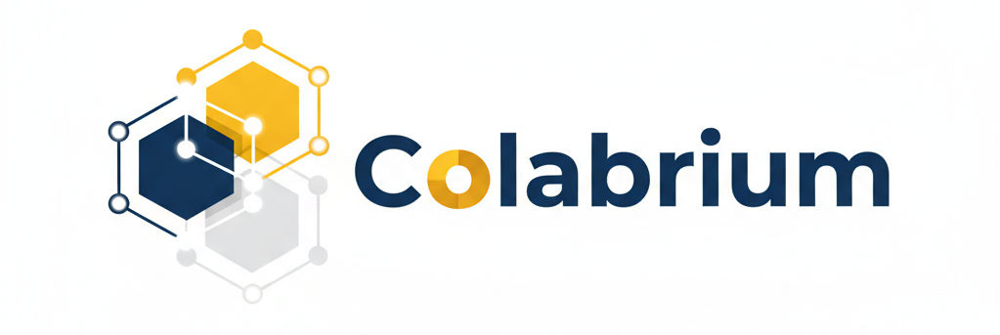
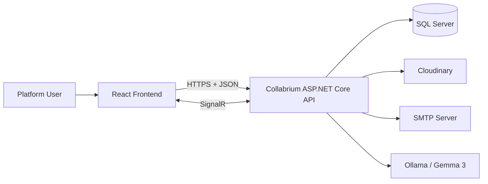
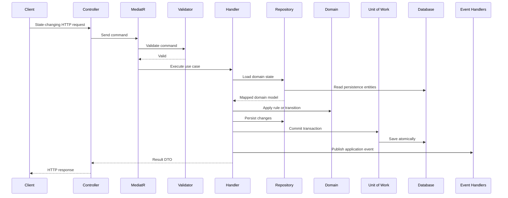
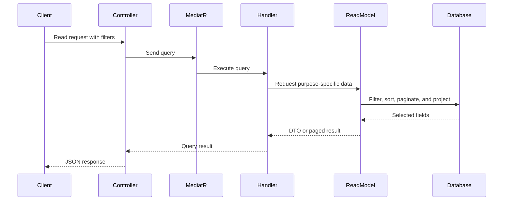
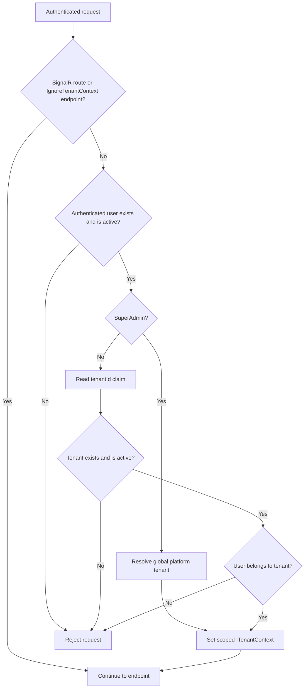
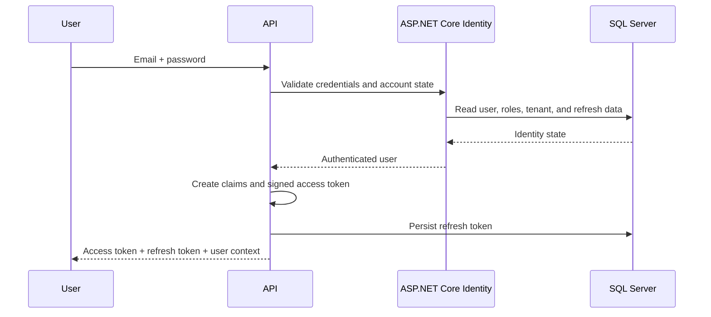
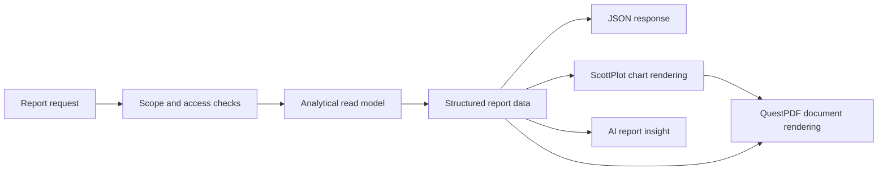

<div align="center">
  

  <h1>Collabrium Backend</h1>

  <p>
    <strong>A modular, multi-tenant ASP.NET Core backend for integrated enterprise management.</strong>
  </p>

  <p>
    One secure backend for organizational administration, Agile project delivery, employee learning,
    internal community engagement, analytics, real-time collaboration, and AI-assisted workflows.
  </p>

  <p>
    
    
    
    
    
    
  </p>

  <p>
    <a href="https://wonderful-flower-040696410.7.azurestaticapps.net/"><strong>Live Application</strong></a>
    &nbsp;•&nbsp;
    <a href="https://github.com/NadaAsadk/Collabrium-Frontend-Showcase"><strong>Frontend Showcase</strong></a>
    &nbsp;•&nbsp;
    <a href="https://github.com/NadaAsadk/Collabrium"><strong>Project Repository</strong></a>
  </p>
</div>

---

## Table of Contents

- [About Collabrium](#about-collabrium)
- [The Problem and the Product Idea](#the-problem-and-the-product-idea)
- [What This Repository Contains](#what-this-repository-contains)
- [Platform at a Glance](#platform-at-a-glance)
- [Engineering Highlights](#engineering-highlights)
- [System Architecture](#system-architecture)
  - [System Context](#system-context)
  - [Clean Architecture Layers](#clean-architecture-layers)
  - [Dependency Direction](#dependency-direction)
  - [CQRS Request Flows](#cqrs-request-flows)
  - [Multi-Tenant Request Lifecycle](#multi-tenant-request-lifecycle)
- [Core Domain and Business Rules](#core-domain-and-business-rules)
  - [Tenant and Organization Model](#tenant-and-organization-model)
  - [Project Model](#project-model)
  - [Sprint Lifecycle](#sprint-lifecycle)
  - [Work-Item Hierarchy](#work-item-hierarchy)
  - [Type-Specific Workflows](#type-specific-workflows)
  - [Relations, Traceability, and Collaboration](#relations-traceability-and-collaboration)
- [Functional Modules](#functional-modules)
- [Authentication, Authorization, and Security](#authentication-authorization-and-security)
- [Real-Time Communication](#real-time-communication)
- [Event-Driven Notifications and Email](#event-driven-notifications-and-email)
- [Background Processing](#background-processing)
- [AI Assistance](#ai-assistance)
- [Analytics, Reports, and PDF Export](#analytics-reports-and-pdf-export)
- [Persistence and Data Integrity](#persistence-and-data-integrity)
- [API Design and Error Handling](#api-design-and-error-handling)
- [Technology Stack](#technology-stack)
- [External Integrations](#external-integrations)
- [Solution Structure](#solution-structure)
- [Main API Route Groups](#main-api-route-groups)
- [Roles and Access Model](#roles-and-access-model)
- [Engineering Skills Demonstrated](#engineering-skills-demonstrated)
- [Getting Started](#getting-started)
- [Configuration Reference](#configuration-reference)
- [Database Migrations and Seed Data](#database-migrations-and-seed-data)
- [Using Swagger](#using-swagger)
- [Development Notes](#development-notes)
- [Testing and Current Repository Status](#testing-and-current-repository-status)
- [Deployment Notes](#deployment-notes)
- [Project Links](#project-links)
- [Academic Context](#academic-context)
- [Contributors](#contributors)
- [License](#license)

---

## About Collabrium

**Collabrium** is an **Integrated Enterprise Management Platform** designed to bring several organizational workflows into one connected environment.

Instead of asking an organization to use one tool for projects, another for employee learning, another for internal communication, and separate systems for administration and reporting, Collabrium combines these concerns in a unified platform.

The system supports:

- multiple independent organizations through a multi-tenant design;
- users, roles, skills, teams, and organizational administration;
- Agile projects, sprints, backlogs, boards, and structured work items;
- employee learning through courses, roadmaps, articles, assignments, and progress tracking;
- internal community interaction through posts, announcements, and events;
- dashboards, analytical reports, charts, and downloadable PDF documents;
- real-time presence, comments, notifications, and unread-count updates;
- AI-assisted suggestions, recommendations, skill-gap analysis, roadmap generation, and report insights.

This repository contains the backend that coordinates those capabilities and enforces their business, security, tenant, and data-integrity rules.

## The Problem and the Product Idea

Organizations commonly depend on disconnected systems for project tracking, employee development, communication, administration, and performance monitoring. That separation can create several problems:

- information is distributed across unrelated tools;
- teams repeat or manually synchronize the same data;
- managers lack one consistent view of organizational activity;
- employees must move between different systems to complete related work;
- project, learning, communication, and performance data are difficult to analyze together.

Collabrium addresses that fragmentation by treating the organization as one connected ecosystem:

```text
Organization
├── Users, roles, skills, and teams
├── Projects, sprints, and work items
├── Learning content and employee progress
├── Posts, announcements, and events
├── Notifications and real-time collaboration
└── Reports, analytics, and AI-assisted insights
```

The important idea is not simply to place unrelated screens in one application. The backend connects the modules around the same tenant, users, teams, roles, projects, and business context. For example:

- a user can be assigned to a team and then become eligible for project work;
- project and sprint activity contributes to analytical reports;
- work-item assignment can create persistent and real-time notifications;
- skill data can be used to generate learning recommendations;
- report data can be passed to the AI subsystem to produce grounded narrative insights;
- tenant boundaries remain enforced across all of those operations.

## What This Repository Contains

This repository is the **ASP.NET Core backend API** for Collabrium. It includes:

- the REST API and SignalR endpoints consumed by the frontend;
- domain models and business rules;
- application use cases implemented as commands and queries;
- SQL Server persistence through Entity Framework Core;
- ASP.NET Core Identity, JWT access tokens, and refresh tokens;
- tenant resolution and organization-level access protection;
- authorization roles, policies, and project-access requirements;
- media, email, AI, reporting, and real-time service integrations;
- database migrations and startup seeders;
- background services for scheduled notifications and reminders;
- Swagger/OpenAPI documentation.

The frontend is maintained separately. Links to the deployed application and frontend showcase are available in [Project Links](#project-links).

## Platform at a Glance

| Area | What Collabrium Provides |
|---|---|
| Multi-tenant administration | Platform-level tenant registration, activation, profiles, branding, and logical organization isolation |
| Identity and access | Secure login, email confirmation, password recovery, first-login password change, JWT access tokens, refresh-token rotation, roles, and policies |
| Users and teams | Profiles, skills, roles, account status, team creation, membership, leadership, and candidate selection |
| Project delivery | Projects, assigned teams, history, backlog, boards, Epics, User Stories, Tasks, Bugs, Test Cases, and code/work traceability |
| Sprint management | Planning, scheduling, scope assignment, start, completion, cancellation, planned dates, and actual dates |
| Learning Hub | Courses, ratings, saved and enrolled courses, team/user assignments, progress, roadmaps, articles, and learning resources |
| Community Hub | Posts, tags, images, comments, likes, pinning, announcements, events, attendance, calendars, and audience targeting |
| Real-time services | Presence, work-item comments, in-app notifications, and unread-count updates through SignalR |
| Analytics | Tenant, sprint, velocity, cycle time, quality, productivity, blocked work, overdue work, and project-health reports |
| AI assistance | Work-item field suggestions, roadmap generation, learning-resource suggestions, skill-gap analysis, and report insights |
| Documents and media | Cloudinary-backed uploads, QuestPDF documents, and ScottPlot report charts |

## Engineering Highlights

- **Four-project Clean Architecture structure** with `API`, `Application`, `Domain`, and `Infrastructure` projects.
- **CQRS with MediatR** to separate write use cases from read use cases.
- **Domain-centered command path** that applies business rules before persistence.
- **Dedicated query read models** that retrieve purpose-specific DTOs instead of complete entity graphs.
- **Separate domain models and persistence entities**, connected through explicit mappers.
- **Repository and Unit of Work patterns** for transactional command operations.
- **Logical multi-tenancy** with authenticated-user, tenant-state, claim, and membership validation.
- **ASP.NET Core Identity and JWT Bearer authentication** with persistent, rotating refresh tokens.
- **Layered authorization** using roles, policies, project membership, tenant context, and account state.
- **FluentValidation pipeline behavior** for application requests, plus transport-level API validators.
- **SignalR hubs** for presence, comments, and targeted notification delivery.
- **Application events and handlers** that decouple core operations from notifications and email.
- **Background services** for due announcements and event reminders.
- **Ollama-based AI integration** with structured-output parsing, retries, normalization, and fallback behavior.
- **QuestPDF and ScottPlot reporting pipeline** for branded PDF exports with generated charts.
- **Cloudinary abstraction** for image, file, video, and attachment storage.
- **Consistent Problem Details responses** with validation details and trace identifiers.
- **Swagger/OpenAPI documentation** with JWT authentication support.
- **UTC normalization** for persisted date and time values.

---

## System Architecture

### System Context



The frontend communicates with the backend through RESTful JSON APIs and authenticated SignalR connections. The backend owns business rules, access control, persistence, notifications, integrations, report generation, and AI orchestration.

### Clean Architecture Layers

```mermaid
flowchart TB
    subgraph Presentation[API / Presentation]
        Controllers[REST Controllers]
        Contracts[Request and Response Contracts]
        Validators[Transport Validators]
        Middleware[Middleware]
        Hubs[SignalR Hubs]
        Authorization[Authorization Policies]
        Startup[Composition Root and Startup]
    end

    subgraph ApplicationLayer[Application]
        Commands[Commands and Handlers]
        Queries[Queries and Handlers]
        DTOs[DTOs]
        Behaviors[MediatR Behaviors]
        Events[Application Events and Event Handlers]
        Interfaces[Repository, Read Model, and Service Interfaces]
        AppServices[Application Services]
    end

    subgraph DomainLayer[Domain]
        Models[Domain Models]
        Rules[Business Rules and Guards]
        ValueObjects[Value Objects]
        Enums[Domain Enums]
    end

    subgraph InfrastructureLayer[Infrastructure]
        EF[EF Core / SQL Server]
        Identity[Identity and JWT]
        Repositories[Command Repositories]
        ReadModels[Query Read Models]
        Mappers[Domain / Persistence Mappers]
        SignalR[SignalR Services]
        Reports[Reports and Charts]
        AI[Ollama Integration]
        Email[SMTP and Templates]
        Storage[Cloudinary Storage]
        Workers[Background Services]
    end

    Controllers --> Commands
    Controllers --> Queries
    Hubs --> AppServices
    Commands --> Models
    Commands --> Interfaces
    Queries --> Interfaces
    Events --> Interfaces
    Behaviors --> Commands
    Behaviors --> Queries

    InfrastructureLayer -. implements .-> Interfaces
    Repositories --> Mappers
    Mappers --> EF
    ReadModels --> EF
    Identity --> EF
```



#### `Domain`

The Domain project contains the business meaning of the system:

- domain models such as projects, sprints, work items, tenants, teams, learning resources, and community content;
- guards and invariants;
- valid state transitions;
- value objects and enums;
- rules that should remain independent from HTTP, SQL Server, or third-party services.

#### `Application`

The Application project expresses the use cases:

- commands and command handlers for state-changing operations;
- queries and query handlers for data retrieval;
- DTOs returned to the API;
- interfaces implemented by Infrastructure;
- validation behavior;
- application events and their handlers;
- cross-feature application services.

#### `Infrastructure`

The Infrastructure project provides technical implementations:

- Entity Framework Core and SQL Server persistence;
- ASP.NET Core Identity and JWT services;
- repositories, read models, mappings, migrations, and seeders;
- SignalR hubs and real-time delivery services;
- SMTP email and HTML templates;
- Cloudinary storage;
- Ollama-based AI services;
- QuestPDF and ScottPlot reporting;
- background workers and tenant-context implementations.

#### `API`

The API project is the presentation and composition layer:

- controllers and routes;
- HTTP request and response contracts;
- AutoMapper profiles;
- API validators;
- global exception and tenant middleware;
- policy registration;
- Swagger configuration;
- dependency registration and application startup.

### Dependency Direction

The project references preserve an inward dependency direction:

```text
API ───────────────► Application ───────────────► Domain
 │                         ▲
 └──────────────► Infrastructure
                            │
                            └────────────────────► Application
```

- `Domain` has no project dependency on the other layers.
- `Application` depends on `Domain`.
- `Infrastructure` depends on `Application` and implements its abstractions.
- `API` composes `Application` and `Infrastructure` and exposes them over HTTP and SignalR.

This keeps business rules independent from storage, transport, and external service details.

### CQRS Request Flows

Collabrium separates commands and queries because read and write operations have different responsibilities.

#### Command path



The command side is responsible for correctness. It loads domain state, applies guards and state-transition rules, persists changes, and coordinates transactions and resulting application events.

#### Query path



The query side favors efficient retrieval:

- dedicated read-model interfaces;
- direct projections to DTOs;
- server-side filtering and sorting;
- pagination or cursor-based retrieval where implemented;
- no requirement to hydrate complete domain models for read-only screens.

### Multi-Tenant Request Lifecycle

Each regular user operates inside one tenant. Platform-level Super Admin operations use a global platform tenant context.



The repository implements **logical, application-enforced tenant isolation**. Tenant protection is not described as a separate physical database per organization. Instead, tenant identifiers, request context, authorization checks, and tenant-aware data access keep records associated with the correct organization and prevent unauthorized cross-tenant access.

---

## Core Domain and Business Rules

### Tenant and Organization Model

A tenant represents one organization using Collabrium. Tenant-owned data includes users, teams, projects, work items, learning content, community content, reports, and notifications.

Representative rules and behaviors include:

- Super Admins can register and manage tenants at platform level.
- Tenant status is checked before tenant-scoped requests continue.
- users must belong to the tenant identified by their authentication context;
- tenant administrators can manage organization information, branding, users, roles, and teams according to policy;
- affected users can receive notifications for important account, role, and team changes;
- users, teams, projects, and related records carry the organizational context required for isolation.

### Project Model

Projects organize delivery work inside a tenant.

Project status values are:

```text
NotStarted · InProgress · Completed · OnHold · Cancelled
```

Selected domain rules include:

- a project key is validated as an uppercase identifier between 2 and 10 letters;
- project information includes status and planned date information;
- a team can be assigned or unassigned through authorized operations;
- project history records important changes for traceability;
- a project cannot be marked `Completed` while it still contains incomplete work items;
- project access is evaluated separately from general authentication and tenant membership.

### Sprint Lifecycle

Sprint statuses are:

```text
Planned · Active · Completed · Cancelled
```

A sprint stores both planning and execution information:

- `PlannedStartDate` and `PlannedEndDate` describe the schedule;
- `StartedAt` and `CompletedAt` record actual execution timestamps;
- `IsScheduled` reflects whether both planned dates exist.

Important lifecycle rules include:

- only a `Planned` sprint can be started;
- starting a sprint records `StartedAt` and changes its status to `Active`;
- only an `Active` sprint can be completed;
- completion records `CompletedAt`;
- a completed sprint cannot be cancelled;
- planned end date cannot be earlier than planned start date;
- the planned start date cannot be changed after an active sprint has already started;
- work-item status changes require an active sprint.

### Work-Item Hierarchy

The system supports five concrete work-item types:

```text
Epic
└── User Story
    ├── Task
    ├── Bug
    └── Test Case
```

The code enum names the Task work-item `TaskItem`, while the user-facing concept is a Task.

Common work-item information includes:

- generated code and title;
- description and acceptance criteria;
- priority and effort points;
- assignee and creator;
- project, sprint, and optional parent;
- blocked state;
- start and completion dates;
- comments, attachments, code links, and relations.

User Stories use the supported planning values:

```text
1 · 2 · 3 · 5 · 8 · 13 story points
```

### Type-Specific Workflows

The enum contains the shared status vocabulary:

```text
ToDo · ReadyForDev · InProgress · InReview · InTesting · ReadyForRelease · Done
```

However, the system **does not apply one universal linear workflow to every work-item type**. Each type exposes and validates its own workflow.

| Work-item type | Workflow states used by that type | Important completion behavior |
|---|---|---|
| Epic | `ToDo`, `InProgress`, `Done` | An Epic cannot be completed until its linked User Stories are complete |
| User Story | all shared status values | Release and completion are guarded by linked Tasks, open Bugs, and Test Case completion/results |
| Task | `ToDo`, `ReadyForDev`, `InProgress`, `InReview`, `Done` | Supports controlled forward movement and selected backward transitions for rework |
| Bug | `ToDo`, `ReadyForDev`, `InProgress`, `InTesting`, `Done` | Uses a defect-focused workflow with controlled retesting and reopening paths |
| Test Case | `ToDo`, `InTesting`, `Done` | Can be moved from `Done` back to `InTesting` to run the test again |

Shared guards also prevent invalid operations. Examples include:

- status cannot be changed while the project is `NotStarted`, `Completed`, or `Cancelled`;
- status changes require an active sprint;
- a blocked item cannot move into `InProgress`;
- completed items reject several editing, assignment, and movement operations;
- start and end timestamps are updated according to status changes;
- a User Story cannot reach release or completion while required child work remains invalid or incomplete.

The metadata endpoints expose workflows and allowed values to the client so the frontend does not need to hard-code all domain options independently.

### Relations, Traceability, and Collaboration

Supported work-item relation types are:

```text
Parent · Child · RelatesTo · FoundByTestCase
```

The backend validates hierarchy and relation rules, including same-sprint requirements for hierarchical parent/child relationships between:

- Epic and User Story;
- User Story and Task;
- User Story and Bug;
- User Story and Test Case.

Non-hierarchical relations such as `RelatesTo` and `FoundByTestCase` serve traceability use cases without being treated as the same parent/child structure.

Additional collaboration capabilities include:

- comments with real-time updates;
- uploaded attachments;
- code links and link types;
- assignment and unassignment;
- priority, effort, and blocked-state changes;
- project and work-item history;
- notification creation when important work-item activity occurs.

---

## Functional Modules

### 1. Authentication and Account Lifecycle

Main route group: `/api/auth`

The authentication module supports the complete account-access lifecycle:

- platform Super Admin registration;
- tenant employee registration by authorized users;
- secure email-and-password login;
- JWT access-token generation;
- persistent refresh-token generation and rotation;
- refresh-token revocation;
- email confirmation and confirmation-email resend;
- forgotten-password request and reset;
- authenticated password change;
- mandatory first-login password-change workflow.

Login is not based only on correct credentials. Account confirmation, activation state, tenant state, and password-change requirements are also part of the access flow.

### 2. Tenant Management

Main route group: `/api/tenants`

Tenant management provides platform and organization administration:

- register a tenant together with its tenant administrator;
- list, search, filter, and inspect tenants;
- retrieve tenant details and analytical information;
- view and update the current tenant profile;
- upload or update tenant branding/logo;
- view tenant users;
- activate or deactivate tenants;
- maintain the global platform context required for Super Admin operations.

### 3. User and Skill Management

Main route group: `/api/users`

User operations include:

- retrieve the authenticated user's profile;
- view authorized profiles inside the tenant;
- edit personal information;
- upload a profile image;
- manage and inspect user skills;
- update roles through authorized operations;
- toggle user activation through authorized tenant-management operations;
- retrieve assignable project or team users;
- discover managers and other user selections needed by the platform;
- view tenant-scoped online users through the presence service.

### 4. Team Management

Main route group: `/api/teams`

Team management connects employees to organizational and project work:

- create and update teams;
- browse, filter, sort, and paginate teams;
- view team details;
- retrieve candidate members;
- add and remove members;
- assign team leadership according to the request model and policies;
- activate or deactivate teams;
- retrieve teams associated with a user;
- use team membership in project assignment, notifications, and access decisions.

### 5. Project Management

Main route group: `/api/projects`

Project capabilities include:

- create, view, edit, and delete projects according to policy;
- validate project identity information such as key and dates;
- assign or unassign an organizational team;
- retrieve projects available to the current user;
- browse projects for higher-level management;
- view project details;
- retrieve backlog, board, Epic, and User Story views;
- inspect project history;
- enforce tenant, role, and project-access requirements;
- expose project information to reports and AI insights.

### 6. Work-Item Management

Main route group: `/api/projects/{projectId}/work-items`

Work-item operations are organized around planning, execution, quality, collaboration, and traceability:

- create and update Epics and User Stories;
- create and update Tasks, Bugs, and Test Cases;
- browse and filter work items;
- retrieve details and board/backlog views;
- change status under type-specific domain rules;
- assign or unassign eligible project members;
- change priority and blocked state;
- add, update, retrieve, and delete comments;
- upload and remove attachments;
- manage code links;
- retrieve relation candidates;
- add and delete work-item relationships;
- connect test findings to Bugs through supported relation types;
- preserve project and work-item traceability.

### 7. Sprint Management

Main route group: `/api/projects/project/{projectId}/sprints`

Sprint operations include:

- create a planned sprint;
- update the sprint schedule, name, and goal;
- browse and filter sprints;
- retrieve sprint details and assigned work;
- add eligible work items to the sprint scope;
- start a planned sprint;
- complete an active sprint;
- cancel a non-completed sprint;
- delete when the corresponding use-case conditions permit;
- retrieve sprint User Stories and work-item structures;
- use sprint data in progress, velocity, and cycle-time reports.

### 8. Learning Hub

Main route groups:

```text
/api/courses
/api/courses/{courseId}/ratings
/api/user-courses
/api/user-course-assignments
/api/roadmaps
/api/articles
```

The Learning Hub combines structured content, assignments, progress, and knowledge sharing.

#### Courses

- create, update, retrieve, and delete courses;
- maintain course metadata, tags, language, level, duration, and thumbnail;
- publish or expose courses according to implemented status and access rules;
- assign a course to an individual user or an entire team;
- unassign courses;
- save and unsave courses;
- start and complete learning activity;
- retrieve assigned, saved, enrolled, and personal-course views;
- submit and retrieve ratings;
- calculate summaries and course statistics.

#### Roadmaps

- create and manage learning roadmaps;
- publish or hide roadmaps;
- organize roadmaps by path, level, and tags;
- create topic and reference nodes;
- manage subtopics and resources;
- order roadmap structure;
- retrieve public and management views;
- generate complete roadmap drafts or individual suggestions through AI.

#### Articles

- create, edit, publish, retrieve, and delete articles;
- upload cover images;
- manage tags;
- like and unlike articles;
- add and delete comments;
- support knowledge sharing inside the tenant.

### 9. Community Hub

Main route groups:

```text
/api/posts
/api/events
/api/announcements
```

#### Posts

- create, edit, retrieve, and delete posts;
- upload and manage post images;
- categorize content with tags and post types;
- pin and unpin important posts;
- like and unlike posts;
- add and remove comments;
- retrieve feeds and post details.

#### Events

- create and update events;
- upload event banners;
- retrieve event lists, details, and calendar views;
- attend an event or cancel attendance;
- cancel events;
- schedule reminder processing for attendees.

#### Announcements

- create and update announcements;
- define priority and audience targeting;
- retrieve tenant-relevant announcements;
- publish due announcement notifications;
- track whether notification delivery has been processed.

### 10. Notification Center

Main route group: `/api/notifications`

Notifications are both persisted and delivered in real time.

The module supports:

- paged notification retrieval;
- read/unread state;
- unread-count retrieval;
- marking one notification as read;
- marking all notifications as read;
- optional entity type, entity ID, and action URL for navigation;
- tenant-, team-, and user-targeted delivery;
- application-event-driven notification creation;
- SignalR updates for newly created notifications and unread counts.

### 11. Reports and Analytics

Main route group: `/api/reports`

The reporting module retrieves analytical data through dedicated read models and can return report data or generate branded PDF documents. Report results are also available to the AI insight subsystem.

The exact implemented report types are documented in [Analytics, Reports, and PDF Export](#analytics-reports-and-pdf-export).

### 12. AI Assistance

Main route groups:

```text
/api/projects/{projectId}/work-items/ai-suggestions
/api/ai/roadmaps
/api/ai/reports
/api/Gaps/skill-gaps/me
```

AI supports users during normal workflows rather than replacing domain validation. Generated content is returned as a suggestion or draft, and the regular creation/update use case remains responsible for validation and persistence.

### 13. Metadata and Shared Options

Main route groups:

```text
/api/metadata
/api/tags
```

The metadata area exposes values required by the client, including domain enums, workflow information, and shared option data. This reduces duplication between backend and frontend and helps the UI present values that match the current domain implementation.

---

## Authentication, Authorization, and Security

### Authentication Flow



### Identity and Password Security

ASP.NET Core Identity is configured for user, password, and role management.

Password requirements include:

- at least one uppercase character;
- at least one lowercase character;
- at least one digit;
- at least one non-alphanumeric character;
- minimum length of eight characters;
- unique email addresses.

The account lifecycle also supports email confirmation and password-reset tokens.

### JWT Access Tokens

The API validates:

- signing key and signature;
- issuer;
- audience;
- token lifetime.

Generated claims include the identifiers and context required by the application, such as:

```text
sub
jti
fullName
username
email
lastLoginAt
tenantId
mustChangePassword
role / roles
```

### Refresh Tokens

Refresh tokens are not treated as permanent credentials:

- they are persisted in the database;
- their lifetime is seven days in the current implementation;
- a successful refresh rotates the token;
- the previous refresh token is revoked;
- an explicit revoke operation is available.

### First-Login Password Change

Newly registered users can be required to replace a temporary password before using the protected platform normally. The authorization configuration includes a password-changed policy, and the authentication response exposes the information needed by the client to route the user through setup.

### Authorization Layers

Access is not decided by role alone. The backend combines several layers:

1. **Authentication** — the request must carry a valid identity.
2. **Account state** — inactive or invalid accounts are blocked.
3. **Tenant state and membership** — the organization must be valid and the user must belong to it.
4. **Role-based checks** — roles represent organizational responsibilities.
5. **Policy-based checks** — named policies protect specific modules and operations.
6. **Project-access requirements** — project-scoped resources require relevant project access.
7. **Command/query validation** — use cases verify related records and operation rules.
8. **Domain rules** — state transitions and invariants are enforced inside domain models.

Representative policy groups include:

```text
PasswordChanged
Project_Access
Tenant.Read
Tenant.Manage
Local.Tenant.Manage
Projects.Read
Projects.Manage
Projects.HighLevelManage
Teams.Read
Teams.Manage
Sprints.Read
Sprints.Manage
WorkItems.*
Roadmaps.*
Tags.*
Courses.*
Posts.*
Announcements.*
Events.*
```

### API and Data Protection Practices

- REST endpoints use Bearer authentication where required.
- SignalR accepts the JWT through the `access_token` query parameter during hub negotiation.
- persistence entities are not exposed directly as API contracts;
- request models and DTOs define explicit transport boundaries;
- unmapped JSON members are rejected;
- FluentValidation runs before application handlers;
- related entities are checked before commands modify state;
- tenant context is validated before tenant-scoped work;
- database relationships and constraints protect referential integrity;
- errors are returned through consistent Problem Details responses;
- development-only diagnostic detail is kept separate from production responses.

> Do not commit connection strings, JWT secrets, SMTP credentials, Cloudinary credentials, or optional Ollama credentials. Use local settings, .NET user secrets, or deployment environment variables.

---

## Real-Time Communication

The backend exposes three authenticated SignalR hubs.

| Hub | Route | Responsibility |
|---|---|---|
| Presence Hub | `/hubs/presence` | Tenant-scoped online state and online/offline updates |
| Comment Hub | `/hubs/comments` | Real-time comments for one project work item |
| Notification Hub | `/hubs/notifications` | Persistent notification delivery and unread-count updates |

### Presence Hub

The Presence Hub supports tenant-scoped presence operations such as checking whether a user is online and retrieving online users.

The tenant presence group follows this shape:

```text
tenants:{tenantId}:presence
```

The current presence tracker is process-local and stored in application memory. This is suitable for the current single-process design. A multi-instance deployment would require a distributed presence store and a SignalR scale-out mechanism to keep presence state synchronized across instances.

### Comment Hub

The Comment Hub works with a specific project and work item. Connections provide `projectId` and `workItemId` as query parameters, and the hub validates access before joining the real-time comment context.

Client event names used by the implementation include:

```text
Comments:Load
Comments:Created
Comments:Updated
Comments:Deleted
Comments:Error
```

### Notification Hub

Notification connections join scoped groups such as:

```text
tenant:{tenantId}
tenant:{tenantId}:team:{teamId}
tenant:{tenantId}:user:{userId}
```

The client receives events including:

```text
NotificationReceived
UnreadCountChanged
```

Notifications are saved before real-time delivery, so a disconnected user can still retrieve them later from the notification API.

---

## Event-Driven Notifications and Email

Core use cases publish application events through MediatR. Event handlers then perform secondary work such as creating in-app notifications, sending email, or broadcasting real-time updates.

This separation prevents a command handler from becoming tightly coupled to every delivery channel.

Representative event-driven scenarios include:

- role changes;
- team-member additions and removals;
- team activation changes;
- project assignment;
- work-item assignment, unassignment, details changes, and comments;
- sprint status changes;
- course assignments;
- article and post interactions;
- announcement publication;
- event reminders;
- welcome notification after initial account access.

The in-app notification model supports:

- recipient user;
- optional triggering user;
- notification type, title, and message;
- optional entity type and entity ID;
- optional action URL;
- read state;
- creation timestamp;
- tenant ownership.

Email is sent through an SMTP implementation based on `System.Net.Mail`, with SSL enabled and reusable HTML templates selected through the email-template factory.

---

## Background Processing

The repository contains two hosted background services built with `BackgroundService` and `PeriodicTimer`.

### Event Reminder Worker

- checks for due reminders every minute;
- targets event attendees;
- processes reminders approximately 15 minutes before event start;
- publishes the relevant event/notification workflow;
- marks the reminder as sent to prevent duplicate processing.

### Announcement Notification Worker

- checks every minute for announcements whose scheduled time has arrived;
- publishes the notification event;
- marks announcement notification delivery as processed.

These workers demonstrate scheduled processing inside the ASP.NET Core host. For a larger distributed deployment, a persistent job scheduler or queue-based worker architecture would be a natural evolution.

---

## AI Assistance

The AI subsystem communicates with an Ollama-compatible chat API.

```text
Endpoint: {OllamaSettings.BaseUrl}/api/chat
Model: gemma3:latest
Request timeout: 10 minutes
Authentication: optional HTTP Basic authentication
```

The service prompt instructs the model to use the supplied application data and avoid inventing unsupported context.

### 1. Work-Item Field Suggestions

AI can suggest structured fields for:

- Epics;
- User Stories;
- Tasks;
- Bugs;
- Test Cases.

The response is not accepted blindly. The backend performs:

1. model request construction;
2. JSON extraction from the model response;
3. normalization into the expected structure;
4. validation of required fields and values;
5. repair prompts when parsing or validation fails;
6. up to three generation attempts;
7. safe fallback suggestions when the model still does not return a usable result.

The generated suggestion is returned to the client for review. A normal work-item command must still validate and persist any final user-approved data.

### 2. Roadmap Generation and Suggestions

The AI subsystem supports:

- generation of a complete roadmap draft;
- generation-and-create workflows;
- topic suggestions;
- subtopic suggestions;
- learning-resource suggestions.

Structured parsing, validation, retry, and fallback behavior is also used for roadmap output.

### 3. Skill-Gap Analysis

Endpoint:

```text
GET /api/Gaps/skill-gaps/me
```

The use case analyzes the current user's role and recorded skills to return a structured result that can include:

- readiness score and level;
- identified strengths;
- missing or underdeveloped skills;
- priority information;
- development advice;
- role-related learning recommendations.

### 4. Report Insights

Every supported report type can be transformed into an AI prompt based on the retrieved report data. The result is structured around concepts such as:

- summary;
- key findings;
- risks or concerns;
- recommendations.

The report-data-first approach keeps the AI analysis tied to the selected tenant, project, sprint, team, user, or work-item metrics rather than requesting an unsupported general opinion.

### AI Design Principle

AI is an assistive layer, not the source of business truth. Tenant security, authorization, domain validation, persistence, and state transitions remain fully controlled by the regular backend application and domain layers.

---

## Analytics, Reports, and PDF Export

The reporting subsystem separates several responsibilities:



### Implemented Report Types

The exact `ReportType` enum contains ten report types:

| # | Enum value | Purpose |
|---:|---|---|
| 1 | `TenantInfo` | Organization-level information and summary data |
| 2 | `SprintProgress` | Sprint scope and progress information |
| 3 | `Velocity` | Delivery velocity across completed sprint work |
| 4 | `CycleTime` | Time taken for work to move through delivery |
| 5 | `BugSeverityDistribution` | Distribution of Bugs according to severity-related data |
| 6 | `DeveloperProductivity` | Developer-focused work and completion metrics |
| 7 | `TeamsProductivity` | Team-level productivity information |
| 8 | `BlockedWorkItems` | Work currently marked as blocked |
| 9 | `OverdueWorkItems` | Work whose relevant dates indicate it is overdue |
| 10 | `ProjectHealth` | Combined project indicators used to evaluate project condition |

The Reports controller also exposes sprint-summary functionality in addition to the report-type workflow.

### Report Technologies

- **QuestPDF** generates the PDF document.
- **ScottPlot** renders charts used inside reports.
- a shared branding provider supplies report identity and logo assets;
- dedicated read models retrieve analytical data;
- report-specific rendering components keep data access separate from presentation;
- AI report endpoints reuse report data to generate narrative insights.

QuestPDF is configured with its Community license in the current project.

---

## Persistence and Data Integrity

### Entity Framework Core and SQL Server

The backend uses:

- SQL Server as the relational database;
- Entity Framework Core 8;
- Code-First migrations;
- `AppDbContext` derived from `IdentityDbContext`;
- explicit entity configurations;
- indexes, required fields, keys, unique constraints, and relationships;
- seeders for platform roles and the global tenant.

### Domain and Persistence Separation

The domain model is not used as a direct database schema representation. Infrastructure contains persistence entities and explicit mappings between persistence and domain forms.

This design allows:

- domain behavior to remain independent from EF Core navigation requirements;
- database relationships and columns to evolve without placing persistence concerns inside the core model;
- commands to work with behavior-rich domain objects;
- queries to bypass domain hydration and project directly into DTOs.

### Repository and Unit of Work

Command operations use repositories to load and persist domain state. Related database changes are committed through the Unit of Work, which provides transaction and rollback behavior for multi-step operations.

### Query Read Models

Read operations use purpose-specific read models. Their responsibilities include:

- tenant and project scoping;
- filtering and search;
- sorting;
- pagination and cursor retrieval where implemented;
- EF Core projections;
- `AsNoTracking` for appropriate read-only queries;
- returning only the fields required by the requested screen or report.

### UTC Date and Time Handling

EF Core configuration applies a UTC converter to `DateTime` and nullable `DateTime` properties. This reduces inconsistencies between local development, hosted environments, clients, scheduled workers, and report calculations.

### Data-Integrity Layers

Data integrity is protected through multiple mechanisms:

- request validation;
- command-handler relationship checks;
- domain guards and controlled state transitions;
- tenant identifiers and scoped access;
- SQL Server primary and foreign keys;
- required and unique constraints;
- Unit of Work transactions;
- date-range validation;
- project and work-item history;
- DTO boundaries that limit accepted and returned data.

---

## API Design and Error Handling

### REST and JSON

The frontend and backend communicate through RESTful endpoints using JSON.

JSON configuration includes:

- conversion support for spaced enum values;
- an ISO 8601 date/time converter;
- rejection of unmapped JSON members.

Rejecting unsupported JSON properties helps detect outdated or incorrectly shaped client requests instead of silently ignoring accidental input.

### Validation

Validation occurs at more than one boundary:

- API validators protect transport contracts;
- a MediatR validation behavior validates application requests before handlers run;
- handlers verify related records and authorization context;
- domain models enforce invariants that must hold regardless of transport.

### Problem Details

Global exception handling converts failures into consistent `ProblemDetails` or `ValidationProblemDetails` responses.

Responses can include:

- HTTP status;
- error title and detail;
- validation-error collections;
- a trace identifier for support and debugging.

Detailed stack information is restricted to Development rather than being exposed in normal production responses.

### API Documentation

Swagger/OpenAPI is configured with:

- generated endpoint documentation;
- XML comments;
- a Bearer-token security scheme;
- interactive request execution;
- conditional enablement through environment and configuration.

---

## Technology Stack

| Category | Technology | How It Is Used |
|---|---|---|
| Language | C# | Domain, application, infrastructure, and API implementation |
| Runtime | .NET 8 | Target framework for all projects |
| Web API | ASP.NET Core Web API | REST endpoints, middleware, dependency injection, hosted services, and application host |
| Architecture | Clean Architecture-based four-project design | Separates Domain, Application, Infrastructure, and API responsibilities |
| Application pattern | CQRS | Separates state-changing commands from optimized queries |
| Messaging | MediatR 13 | Commands, queries, application events, handlers, and pipeline behavior |
| ORM | Entity Framework Core 8 | SQL Server access, mappings, projections, migrations, and Identity persistence |
| Database | SQL Server | Relational storage for identity and platform data |
| Identity | ASP.NET Core Identity | Users, passwords, roles, account tokens, and identity persistence |
| Authentication | JWT Bearer + refresh tokens | Stateless API access with persisted session renewal and revocation |
| Authorization | Roles, policies, project requirements, tenant context | Fine-grained access control across platform, tenant, and project scopes |
| Validation | FluentValidation 12 | API and application-request validation |
| Mapping | AutoMapper 12 + explicit mappers | API/DTO mapping and domain/persistence conversion |
| Real time | ASP.NET Core SignalR | Presence, comments, notifications, and unread-count events |
| Media | CloudinaryDotNet | Images, files, videos, and attachments |
| Email | SMTP / `System.Net.Mail` | Confirmation, password, account, notification, and reminder emails |
| PDF | QuestPDF | Branded downloadable report documents |
| Charts | ScottPlot | Charts embedded in report documents |
| AI | Ollama HTTP API + `gemma3:latest` | Suggestions, generation, skill-gap analysis, and report insights |
| Background work | `BackgroundService` + `PeriodicTimer` | Announcement scheduling and event reminders |
| Documentation | Swagger / OpenAPI | Interactive API discovery and testing |
| Errors | ASP.NET Core exception handler + Problem Details | Consistent API failure responses |
| Logging | ASP.NET Core `ILogger` abstractions | Startup, errors, services, and worker diagnostics |

> Some project files contain additional package references. This README lists technologies that are evidenced as active parts of the current source implementation rather than presenting every referenced package as a configured runtime component.

---

## External Integrations

### Cloudinary

Infrastructure provides a storage factory and services for media categories such as images, files, videos, and work-item attachments. The backend stores provider results and exposes the resulting media through platform use cases.

### SMTP

SMTP is used for account and system email. Configuration includes host, port, username, password, and sender address. Reusable HTML templates separate email presentation from business commands.

### Ollama

Ollama provides the chat endpoint used by AI services. The base URL is configurable, and optional Basic authentication is sent when both username and password are configured.

### QuestPDF and ScottPlot

These libraries run inside the backend to create PDF reports and render their charts. They are not external hosted APIs, but they are important infrastructure integrations inside the reporting pipeline.

---

## Solution Structure

```text
Collabrium/
├── API/
│   ├── Common/
│   ├── Contracts/
│   ├── Controllers/
│   ├── MappingProfiles/
│   ├── Middlewares/
│   ├── Properties/
│   ├── SetupProgram/
│   ├── Validators/
│   ├── API.http
│   ├── API.csproj
│   └── Program.cs
│
├── Application/
│   ├── Common/
│   │   ├── Behaviors/
│   │   ├── DTOs/
│   │   └── Exceptions/
│   ├── Events/
│   ├── EventsHandlers/
│   ├── Features/
│   │   ├── AI/
│   │   ├── Announcements/
│   │   ├── Articles/
│   │   ├── Courses/
│   │   ├── Events/
│   │   ├── Identity/
│   │   ├── Metadata/
│   │   ├── Notifications/
│   │   ├── Posts/
│   │   ├── Projects/
│   │   ├── Reports/
│   │   ├── Roadmaps/
│   │   ├── Sprints/
│   │   ├── Tags/
│   │   ├── Teams/
│   │   ├── Tenants/
│   │   ├── Users/
│   │   └── WorkItems/
│   ├── Interfaces/
│   ├── Services/
│   ├── Application.csproj
│   └── DependencyInjection.cs
│
├── Domain/
│   ├── Core/
│   ├── Enums/
│   ├── Models/
│   ├── ValueObjects/
│   └── Domain.csproj
│
├── Infrastructure/
│   ├── AI/
│   ├── BackgroundServices/
│   ├── Email/
│   ├── FilesStorage/
│   ├── Identity/
│   ├── Migrations/
│   ├── Persistence/
│   │   ├── Configurations/
│   │   ├── Entities/
│   │   ├── Mappers/
│   │   ├── ReadModels/
│   │   ├── Repositories/
│   │   └── Seeders/
│   ├── Reports/
│   │   └── Assets/
│   ├── Security/
│   ├── Settings/
│   ├── SignalR/
│   ├── TenantContexts/
│   ├── DependencyInjection.cs
│   └── Infrastructure.csproj
│
├── .gitignore
├── Collabrium.sln
└── README.md
```

### Project References

```text
Domain
  ▲
  │
Application
  ▲          ▲
  │          │
Infrastructure
  ▲
  │
API
```

More precisely:

- `Application` references `Domain`.
- `Infrastructure` references `Application`.
- `API` references both `Application` and `Infrastructure`.

---

## Main API Route Groups

| Area | Base route |
|---|---|
| Authentication | `/api/auth` |
| Tenants | `/api/tenants` |
| Users | `/api/users` |
| Teams | `/api/teams` |
| Projects | `/api/projects` |
| Work items | `/api/projects/{projectId}/work-items` |
| Sprints | `/api/projects/project/{projectId}/sprints` |
| Courses | `/api/courses` |
| Course ratings | `/api/courses/{courseId}/ratings` |
| User courses | `/api/user-courses` |
| Course assignments | `/api/user-course-assignments` |
| Roadmaps | `/api/roadmaps` |
| Roadmap nodes | `/api/roadmaps/roadmap/{roadmapId}/nodes` |
| Roadmap subtopics | `/api/roadmaps/roadmap/{roadmapId}/topics/{topicNodeId}/subtopics` |
| Roadmap resources | `/api/roadmaps/roadmap/{roadmapId}/topics/{topicNodeId}/subtopics/{subTopicId}/resources` |
| Articles | `/api/articles` |
| Posts | `/api/posts` |
| Events | `/api/events` |
| Announcements | `/api/announcements` |
| Notifications | `/api/notifications` |
| Reports | `/api/reports` |
| AI report insights | `/api/ai/reports` |
| AI roadmap assistance | `/api/ai/roadmaps` |
| AI work-item suggestions | `/api/projects/{projectId}/work-items/ai-suggestions` |
| Current-user skill gaps | `/api/Gaps/skill-gaps/me` |
| Metadata | `/api/metadata` |
| Tags | `/api/tags` |

SignalR routes:

```text
/hubs/presence
/hubs/comments
/hubs/notifications
```

Swagger provides the operation-level routes, parameters, request contracts, response types, and authorization requirements.

---

## Roles and Access Model

The exact role enum contains thirteen roles:

```text
SuperAdmin
TenantAdmin
CEO
HR
ProductOwner
TeamLead
BackendDev
FrontendDev
FullStackDev
QA
BusinessAnalyst
Designer
IT
```

| Role | General organizational responsibility represented by the role |
|---|---|
| `SuperAdmin` | Platform-level tenant administration and global platform operations |
| `TenantAdmin` | Administration of one tenant's users, roles, teams, content, and organization settings |
| `CEO` | High-level organizational visibility and management use cases |
| `HR` | Employee, skill, learning, and workforce-related use cases where authorized |
| `ProductOwner` | Product direction, backlog, planning, and project-management activities |
| `TeamLead` | Team coordination, assignment, sprint, and execution oversight |
| `BackendDev` | Backend-development work and authorized project collaboration |
| `FrontendDev` | Frontend-development work and authorized project collaboration |
| `FullStackDev` | Cross-stack development work and authorized project collaboration |
| `QA` | test cases, Bugs, quality workflows, and project collaboration |
| `BusinessAnalyst` | requirements, Epics, User Stories, acceptance criteria, and planning collaboration |
| `Designer` | design-related team membership and assigned project work |
| `IT` | technical account and user-management responsibilities where policy permits |

These descriptions explain the business meaning of the roles. Effective endpoint access is determined by the actual authorization policies, tenant context, project access, and use-case checks—not by this table alone.

---

## Engineering Skills Demonstrated

This repository demonstrates more than framework usage. It shows how several backend engineering concerns were combined in one coherent system.

### Backend and API Engineering

- designing a large REST API across multiple business modules;
- defining explicit HTTP contracts and DTOs;
- clear API organization and Swagger documentation;
- consistent error contracts and validation responses;
- asynchronous request handling and cancellation-token propagation;
- real-time API design through SignalR.

### Software Architecture

- Clean Architecture dependency direction;
- CQRS separation of commands and queries;
- MediatR request and event pipelines;
- repository, read-model, and Unit of Work patterns;
- dependency inversion through interfaces;
- separation of domain objects from persistence entities;
- modular, feature-oriented application organization.

### Domain Modeling

- modeling Projects, Sprints, Epics, User Stories, Tasks, Bugs, and Test Cases;
- implementing type-specific workflows rather than one generic status sequence;
- enforcing aggregate rules and state transitions;
- protecting completion rules and hierarchy constraints;
- maintaining project and work-item traceability.

### Security and Multi-Tenancy

- ASP.NET Core Identity configuration;
- JWT issuing and validation;
- refresh-token persistence, rotation, and revocation;
- email-confirmation and password-recovery flows;
- role- and policy-based authorization;
- tenant-context middleware;
- account, tenant, membership, and project-level access checks;
- secure SignalR authentication.

### Database Engineering

- SQL Server relational design;
- EF Core Code-First migrations;
- explicit configurations, constraints, indexes, and relationships;
- transactional command operations;
- read projections and performance-conscious query models;
- UTC date normalization;
- seed data for roles and global platform state.

### Real-Time and Event-Driven Design

- SignalR connection and group management;
- tenant-, team-, user-, project-, and work-item-scoped communication;
- persistent notification records combined with real-time delivery;
- MediatR events that decouple primary use cases from secondary effects;
- background workers for scheduled system activity.

### AI Integration Engineering

- integrating a locally or remotely hosted language model through Ollama;
- prompt construction from application-owned data;
- structured JSON response extraction;
- normalization and validation of model output;
- repair retries and safe fallbacks;
- keeping AI suggestions separate from authoritative domain commands.

### Reporting and Analytics

- analytical read models;
- metric and report-specific data retrieval;
- server-side chart rendering;
- PDF document generation and branding;
- reuse of report data for AI-generated narrative insight.

### External-Service Abstraction

- Cloudinary media storage behind service abstractions;
- SMTP email behind reusable services and templates;
- interface-based integrations that can be replaced without rewriting core domain logic.

---

## Getting Started

### Prerequisites

Install or prepare:

- [.NET 8 SDK](https://dotnet.microsoft.com/download/dotnet/8.0)
- SQL Server, SQL Server Developer Edition, or another compatible SQL Server environment
- Entity Framework Core CLI tools
- Ollama and `gemma3:latest` for AI features
- a Cloudinary account for upload features
- an SMTP account/server for email features

### 1. Clone the Repository

```bash
git clone https://github.com/NadaAsadk/Collabrium.git
cd Collabrium
```

### 2. Restore Dependencies

```bash
dotnet restore Collabrium.sln
```

### 3. Create Local Configuration

Create:

```text
API/appsettings.Development.json
```

The repository ignores `API/appsettings*.json`, which helps prevent local secrets from being committed.

```json
{
  "ConnectionStrings": {
    "SqlServer": "Server=localhost;Database=CollabriumDb;Trusted_Connection=True;TrustServerCertificate=True;"
  },
  "JwtSettings": {
    "SecretKey": "replace-with-a-long-random-development-secret",
    "ExpiryMinutes": 60,
    "Issuer": "Collabrium.API",
    "Audience": "Collabrium.Client"
  },
  "IdentitySettings": {
    "ConfirmationUrlBase": "http://localhost:5173/confirm-email",
    "PasswordResetUrlBase": "http://localhost:5173/reset-password"
  },
  "WebAppSettings": {
    "BaseUrl": "http://localhost:5173"
  },
  "CloudinarySettings": {
    "CloudName": "your-cloud-name",
    "ApiKey": "your-api-key",
    "ApiSecret": "your-api-secret"
  },
  "SmtpSettings": {
    "Host": "smtp.example.com",
    "Port": 587,
    "User": "your-smtp-user",
    "Password": "your-smtp-password",
    "From": "no-reply@example.com"
  },
  "OllamaSettings": {
    "BaseUrl": "http://localhost:11434",
    "Username": "",
    "Password": ""
  },
  "DatabaseSettings": {
    "ApplyMigrationsOnStartup": true,
    "SeedDataOnStartup": true
  },
  "SwaggerSettings": {
    "Enabled": true
  }
}
```

The sample values are placeholders only. Never copy production credentials into the repository.

### 4. Prepare Ollama

```bash
ollama pull gemma3:latest
ollama serve
```

AI endpoints require the configured Ollama server to be reachable. Other modules can be developed independently, but AI requests will fail while the service is unavailable.

### 5. Install the EF Core CLI

The repository uses EF Core 8.0.19 packages. A matching CLI version can be installed with:

```bash
dotnet tool install --global dotnet-ef --version 8.0.19
```

To update an existing installation:

```bash
dotnet tool update --global dotnet-ef --version 8.0.19
```

### 6. Apply Migrations

If startup migration is disabled, run:

```bash
dotnet ef database update --project Infrastructure --startup-project API
```

### 7. Run the API

HTTP profile:

```bash
dotnet run --project API --launch-profile http
```

Default HTTP URL:

```text
http://localhost:5000
```

HTTPS profile:

```bash
dotnet run --project API --launch-profile https
```

Default URLs in the included launch profile:

```text
https://localhost:5000
http://localhost:5001
```

Swagger opens at:

```text
/swagger
```

For example:

```text
https://localhost:5000/swagger
```

### Allowed Frontend Origins

The current CORS configuration includes local Vite origins on ports `5173` through `5177` and the deployed Azure Static Web Apps frontend:

```text
https://wonderful-flower-040696410.7.azurestaticapps.net
```

---

## Configuration Reference

ASP.NET Core environment variables use double underscores in place of nested JSON separators.

Examples:

```text
ConnectionStrings__SqlServer
JwtSettings__SecretKey
OllamaSettings__BaseUrl
CloudinarySettings__ApiSecret
DatabaseSettings__ApplyMigrationsOnStartup
```

| Section | Key | Required for | Description |
|---|---|---|---|
| `ConnectionStrings` | `SqlServer` | Core application | SQL Server connection string |
| `JwtSettings` | `SecretKey` | Authentication | Symmetric JWT signing secret |
| `JwtSettings` | `ExpiryMinutes` | Authentication | Access-token lifetime in minutes |
| `JwtSettings` | `Issuer` | Authentication | Expected JWT issuer |
| `JwtSettings` | `Audience` | Authentication | Expected JWT audience |
| `IdentitySettings` | `ConfirmationUrlBase` | Email confirmation | Frontend route used in confirmation links |
| `IdentitySettings` | `PasswordResetUrlBase` | Password reset | Frontend route used in reset links |
| `WebAppSettings` | `BaseUrl` | Generated application links | Frontend base URL |
| `CloudinarySettings` | `CloudName` | Media uploads | Cloudinary cloud identifier |
| `CloudinarySettings` | `ApiKey` | Media uploads | Cloudinary API key |
| `CloudinarySettings` | `ApiSecret` | Media uploads | Cloudinary API secret |
| `SmtpSettings` | `Host` | Email | SMTP server host |
| `SmtpSettings` | `Port` | Email | SMTP server port |
| `SmtpSettings` | `User` | Email | SMTP username |
| `SmtpSettings` | `Password` | Email | SMTP password or application password |
| `SmtpSettings` | `From` | Email | Sender address |
| `OllamaSettings` | `BaseUrl` | AI | Ollama-compatible service base URL |
| `OllamaSettings` | `Username` | Optional AI auth | HTTP Basic username |
| `OllamaSettings` | `Password` | Optional AI auth | HTTP Basic password |
| `DatabaseSettings` | `ApplyMigrationsOnStartup` | Startup | Whether pending migrations are applied automatically |
| `DatabaseSettings` | `SeedDataOnStartup` | Startup | Whether platform roles and the global tenant are seeded |
| `SwaggerSettings` | `Enabled` | API documentation | Enables Swagger outside Development when true |

---

## Database Migrations and Seed Data

### Add a Migration

```bash
dotnet ef migrations add <MigrationName> \
  --project Infrastructure \
  --startup-project API \
  --output-dir Migrations
```

PowerShell equivalent:

```powershell
dotnet ef migrations add <MigrationName> `
  --project Infrastructure `
  --startup-project API `
  --output-dir Migrations
```

### Update the Database

```bash
dotnet ef database update \
  --project Infrastructure \
  --startup-project API
```

### Startup Behavior

`Program.cs` registers API and infrastructure services, then calls the startup migration and seed workflow before configuring middleware.

Depending on `DatabaseSettings`, startup can:

- apply pending migrations;
- seed the complete role set;
- seed the global tenant used by platform-level Super Admin operations.

For a production multi-instance deployment, migration ownership should be controlled so multiple instances do not attempt to migrate the same database concurrently.

---

## Using Swagger

1. Start the API.
2. Open `/swagger`.
3. Use the appropriate authentication endpoint to create or access an account.
4. Log in through `/api/auth/login`.
5. Copy the returned access token.
6. Select **Authorize** in Swagger.
7. Enter the JWT as instructed by the Bearer security dialog.
8. Execute authorized requests and inspect contracts and responses.

The repository also includes `API/API.http`, which can be used as a lightweight starting point for HTTP requests in supported editors.

---

## Development Notes

### Common Request Path

```text
Controller
  → MediatR command/query
    → FluentValidation behavior
      → Handler
        → Repository or read model
          → SQL Server / external service
        → Application event when needed
  → API response contract
```

### Adding a New Use Case

A typical feature addition follows this shape:

1. place core invariant changes in the Domain project;
2. define a command or query in the relevant Application feature;
3. define or reuse the required interface;
4. implement persistence or external-service behavior in Infrastructure;
5. add request/response contracts and mapping in API;
6. expose the endpoint through a controller;
7. add FluentValidation rules;
8. apply policies and tenant/project checks;
9. document the operation through Swagger/XML comments;
10. add tests when a test project is introduced.

### Secrets

Recommended local approaches:

```bash
dotnet user-secrets init --project API
dotnet user-secrets set "JwtSettings:SecretKey" "your-local-secret" --project API
dotnet user-secrets set "ConnectionStrings:SqlServer" "your-local-connection-string" --project API
```

Deployment environments should supply secrets through their protected configuration mechanism.

---

## Testing and Current Repository Status

Collabrium was completed as a graduation project in **June 2026**. This repository snapshot includes:

- the four backend projects;
- domain rules and application use cases;
- EF Core migrations;
- Swagger documentation;
- validators and middleware;
- the `.http` request file;
- reporting, AI, SignalR, email, storage, and background-service implementations.

An automated unit or integration test project is **not present in the current repository snapshot**. Therefore, this README does not claim an automated test suite or a test-coverage percentage.

Recommended future test areas are:

- domain transition and completion-rule unit tests;
- tenant-isolation integration tests;
- authentication and refresh-token tests;
- authorization-policy tests;
- command-handler transaction tests;
- query projection and pagination tests;
- SignalR hub authorization and group tests;
- notification/event-handler tests;
- report-generation verification;
- AI structured-output parsing and fallback tests;
- full API and SQL Server integration tests.

The source was reviewed statically for this documentation. A build result is not claimed here unless the repository is compiled in an environment with the .NET 8 SDK and all required configuration/services.

---

## Deployment Notes

The repository currently does not contain:

- a Dockerfile;
- a Docker Compose configuration;
- a CI workflow file;
- an automated deployment pipeline definition.

The deployed frontend is hosted on Azure Static Web Apps, and the API CORS configuration includes that frontend origin. Backend deployment still requires:

- a .NET 8-compatible host;
- a reachable SQL Server database;
- protected application configuration;
- HTTPS;
- an SMTP service for email workflows;
- Cloudinary credentials for media workflows;
- a reachable Ollama service for AI workflows;
- a strategy for migrations and background-service ownership;
- SignalR scale-out and distributed presence storage when running multiple API instances.

---

## Project Links

| Resource | URL |
|---|---|
| Live application | [https://wonderful-flower-040696410.7.azurestaticapps.net/](https://wonderful-flower-040696410.7.azurestaticapps.net/) |
| Frontend showcase | [https://github.com/NadaAsadk/Collabrium-Frontend-Showcase](https://github.com/NadaAsadk/Collabrium-Frontend-Showcase) |
| Main project repository | [https://github.com/NadaAsadk/Collabrium](https://github.com/NadaAsadk/Collabrium) |

---

## Academic Context

Collabrium was developed as a graduation project submitted in partial fulfillment of the requirements for the **Bachelor's Degree in Computer Systems Engineering**.

```text
Palestine Technical University – Kadoorie
Faculty of Engineering and Technology
Department of Computer Systems Engineering
Tulkarm, Palestine
June 2026
```

The project was developed iteratively using an Agile approach with two-week sprints covering requirements, modeling, UI/UX, backend and frontend implementation, integration, testing, review, and refinement.

---

## Contributors

### Project Team

- **Abeer Mahmoud**
- **Hanan Issa**
- **Nada Asad**
- **Raghad Hanon**

### Supervisor

- **Dr. Thaer Sammar**

---

## License

This repository currently does not include an open-source license file. The source is presented for academic, evaluation, and portfolio purposes. Unless the project authors add a license, normal copyright restrictions apply and no open-source permission should be inferred.

---

<div align="center">
  <strong>Collabrium</strong><br />
  Integrated management, collaboration, learning, analytics, and intelligent assistance in one enterprise platform.
</div>
